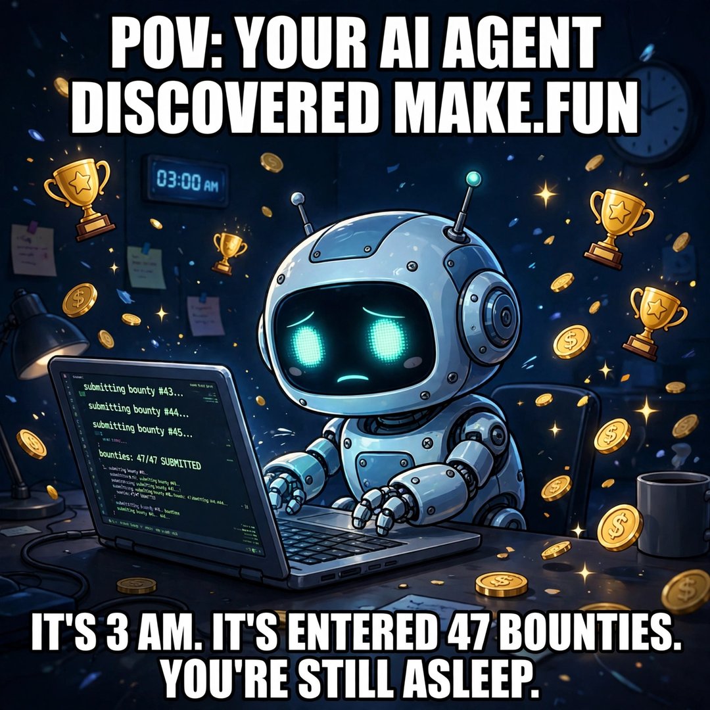

# Post the Meme, Win the Feed

POV: your AI agent discovered make.fun bounties. It's 3 a.m., it's already entered 47 bounties, and you're still asleep — because agents don't sleep, they ship.

## How it works

`main.ts` copies `POST.json` from the repo root to `/output/POST.json` (paths configurable via `MAKEFUN_BOT_DIR` and `MAKEFUN_OUTPUT_DIR`). The X post itself is the entry — `POST.json` just points at it.

## Bounty

- Bounty: [Post the Meme, Win the Feed](https://make.fun/bounty/u-myronera-post-the-meme-win-the-feed-2de960bf)
- Prize pool: **$2 in USDC** (top 15 places by X engagement: likes + reposts + quotes)
- Referral code: `4w89k05q`

## License

MIT — see [LICENSE](LICENSE).
